<p align="center">
  
</p>

<p align="center">
  <a href="https://www.linkedin.com/in/nicolas-gonzalez-toro">LinkedIn</a> ·
  <a href="https://www.behance.net/ngonzalez693">Behance</a> ·
  <a href="mailto:nicogonto@gmail.com">nicogonto@gmail.com</a>
</p>

<br>




<p align="center">
  <a href="https://github.com/Ngonzalez693/PingPro"></a>
  <a href="https://github.com/Ngonzalez693/DeepLearning"></a>
  <a href="https://github.com/Ngonzalez693/NumMethods"></a>
</p>

<br>


<p align="center">
  <a href="https://github.com/Ngonzalez693/Timeless_Racing"></a>
  <a href="https://github.com/Ngonzalez693/Co-op_Game"></a>
</p>

<p align="center">
  <a href="https://www.behance.net/ngonzalez693">3D, motion and video work on Behance →</a>
</p>

<br>

```text
$ systeminfo --short
degrees   B.Sc. Software Systems + B.Sc. Multimedia Engineering (ABET) · 2026
athlete   National-level table tennis
langs     Spanish (native) · English (B2)
location  Cali, Colombia
```
